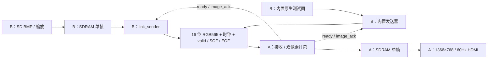

# 双板传输协议与连接

## 数据路径

## 基本规格

- 源同步时钟 12.5 MHz，由 B 板持续输出。
- 16 根数据线，每次 valid && ready 接受一个 RGB565 像素。
- RGB565：data[15:11] 红，data[10:5] 绿，data[4:0] 蓝。
- 固定 1366×768，共 1,049,088 像素、2,098,176 字节。
- A 每两像素打包一个32位字，第一个在高16位、第二个在低16位；每行683字。
- A/B 帧缓存各为524,544个32位字，基地址0。
- 当前一次上电发送一帧，成功后重复显示同一帧，没有连续视频或多帧队列。

## 握手时序

1. B 先呈现第一个像素，valid=1、SOF=1，即使 ready=0 也保持它。
2. A 检测 SOF，向本板帧缓存请求写帧。
3. A 等待写 ACK 置位，再撤销请求；等 ACK 撤销及 FIFO 复位握手结束后才拉 ready。
4. B 在下降沿更新 data/valid/SOF/EOF。A 和 B 都在随后的上升沿判断 valid && ready。
5. ready=0 时 B 保持当前像素及标志，不推进坐标 / 索引。
6. SOF 仅标记第0个像素；EOF 仅标记第1,049,087个像素。
7. A 检查长度和标志，等待全部字实际写入 SDRAM后保持 image_ack=1。
8. B 将 image_ack 两级同步，数码管显示5；A在垂直消隐开始预读图片并持续显示。

A 会在双像素打包字的写入拍暂停 ready，避免待写字与后续输入冲突。
B SD 发送器从注册输出 FIFO 取字后等待一拍，再取高16位 / 低16位，不能按 show-ahead
FIFO 的同拍有效假设读取。
跨时钟域 ACK、完成 toggle 和状态使用同步器；FIFO Gray 地址使用传播时间约束。

**image_ack 不是像素 CRC。** 错误数据只要数量和标志正确，仍可能完成确认。

## 物理连接：两板同名封装引脚相连

| 信号 | A 与 B 的 FPGA 封装引脚 | 方向 |
|---|---|---|
| data[0..3] | P4、N4、N3、M5 | B→A |
| data[4..7] | M3、M4、L3、J3 | B→A |
| data[8..11] | J4、H4、N1、M2 | B→A |
| data[12..15] | M1、L1、H2、H1 | B→A |
| link_clk | G1 | B→A |
| valid | G3 | B→A |
| SOF | L4 | B→A |
| EOF | L5 | B→A |
| ready | K6 | A→B |
| image_ack | H3 | A→B |
| GND | 两板明确标注的 GND 端子 | 共地 |

至少22根信号与1根地；实际短线连接建议多根地，分布到时钟和数据线组旁。
用户此前仅一根GND，尚未确定这是否导致纹波；优先增加3～5根并缩短排线作对照。
封装引脚名称不是 J2 排针序号，需按板卡原理图 / 丝印对应。
两板各自供电，不将两板电源轨相连，断电后改线。
IO延迟约束采用 max 2ns / min 0.5ns 初始假设，不是实际线缆测量值。

## 数码管

| 数字 | A 接收板 | B 内置图版 | B SD版 |
|---|---|---|---|
| 0 | 无 HDMI HPD | 启动等待 | SD 初始化未完成 |
| 1 | 等待 PLL / 自检 | — | 已初始化，扫描 BMP |
| 2 | 自检通过，等图片 | — | 读图、缩放、存入 B SDRAM |
| 3 | 接收中 / 等待写入完成 | 发送中 | 发送中 |
| 4 | 完整帧存入，准备显示 | 发送完，等 A 确认 | 发送完，等 A 确认 |
| 5 | 完成一个图片输出帧，持续输出 | 收到 A 确认 | 收到 A 确认 |
| 6 | 扫描异常 | — | — |
| 7 | 像素时钟异常 | — | — |
| 8 | 读 FIFO 欠载 | — | — |
| 9 | SOF / EOF / 帧长度错误 | — | SD / 缩放 / 写 FIFO 错误 |

A 的5表示FPGA输出流程完成，不表示屏幕反馈锁定。中间数字可能一闪而过。
