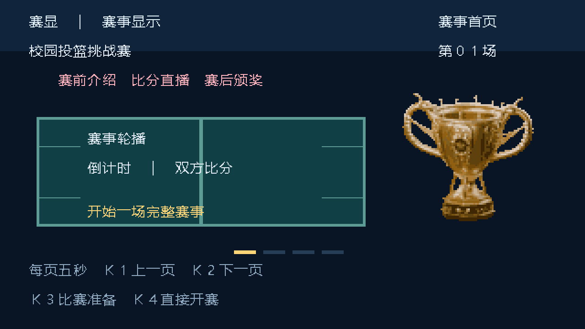

# 赛显：赛事轮播、比分与原工程奖杯单板组合版

单块 HX4S20C / EG4S20BG256，接 **HDMI_A**，无需 TF 卡或串口屏。

- **[下载可烧录文件](delivery/SAIXIAN_EVENT_CAROUSEL_SINGLE_20261026.bit?raw=1)**
- [完整方案、按键与验收步骤](组合方案与使用说明.md)
- [十二种 RTL 仿真画面](delivery/RTL画面预览.png)
- [交付校验与验证记录](delivery/manifest.json)



## 统一赛事流程

赛事首页／双方介绍／赛程检录／上场结果轮播 → 3/2/1 → 实时比分与倒计时 → 原黄金奖杯颁奖 → 最终成绩 → 自动返回轮播。

队名、比分与结果共用状态，修改下一场双方不会覆盖上场结果。每页轮播约 5 秒；赛后先颁奖约 8 秒，再显示成绩约 4 秒。默认比赛 30 秒，也可选择 1、3、5 分钟。

| 阶段 | K1 | K2 | K3 | K4 |
|---|---|---|---|---|
| 赛事轮播 | 上一页 | 下一页 | 比赛准备 | 直接开赛 |
| 比赛准备 | 选择主队 | 选择客队 | 切换时长 | 短按开始；长按返回轮播 |
| 比赛／暂停 | 主队短按加分、长按减分 | 客队短按加分、长按减分 | 暂停／继续 | 长按提前结束 |
| 颁奖／成绩 | 锁定 | 锁定 | — | 返回轮播 |

倒数中长按 K4 取消。长按约 1 秒，比分范围 000～999。平局单独显示，上场结果在断电后不保留。

奖杯来自本仓库原有 `5.0project/award_media/RELIEF720.DLT`，本单板版采用 8 视角、96×96、16 色索引，显示为 384×384；固定光照，不包含双板原版的完整精度和触摸调光。

## 验证状态

- TD 6.2.168116 完成综合、布局布线和 bitgen。
- 建立／保持余量 **+0.106／+0.024 ns**；STNS、HTNS 均为零。
- 资源：4437 LUT、2614 REG、24 RAM9K、9 RAM32K、3 DSP。
- 7 组有效验证，覆盖赛事控制、按键、完整流程、全部 73,728 个奖杯索引像素、12 个完整 720p 场景、HDMI 输入流和提示音。
- 11 个未改内容场景在显示流水优化前后逐像素一致；成绩页标题按设计更新。

仿真画面不是实板录像，仍需本轮单板验收。原 AB 工程未修改；本目录总资源不能视为向原 A 板添加功能的资源增量。

## 源码与复现

- TD 工程：`project/src/td_project/SAIXIAN_EVENT_CAROUSEL_SINGLE.al`
- 顶层：`project/src/user_source/hdl_source/match_top.v`
- 统一流程：`event_flow.v`；赛事控制：`match_control.v`；显示：`match_render.v`
- 活跃 HDL 清单：`results/sources.json`

从本目录运行：

```powershell
python -m pip install -r requirements.txt
python -B tools/test_match.py
python -B tools/build.py
```

工具默认位置：TD `D:/TD`，Icarus `D:/qiansai/.tools/iverilog-portable/ucrt64/bin`。已保存字库、奖杯初始化文件和工程，可直接构建。需要重新生成时运行 `tools/prepare_trophy.py`、`tools/prepare.py`；项目模板已随包保存，奖杯源文件通过仓库相对路径读取，字库使用 Windows 微软雅黑。

`delivery/` 保留已经通过检查的位流及报告；`results/` 保存通过版本的构建记录、测试记录与预览。未包含 TD 数据库、中途失败位流或本地运行缓存。

本分支基于双板集成提交 `4aef3be86313013b666a917b0e575078e4c610a5`，只新增此目录。后续双板移植方案见完整说明。
