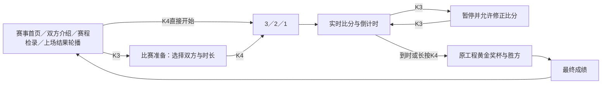

# 赛显：赛事轮播、比分与原工程奖杯单板组合版

日期：2026-10-26。目标板：HX4S20C / EG4S20BG256，接 HDMI_A。用户已选择先用内置赛事页面验收流程，本轮不读取 TF 照片、不提供图像处理设置；原双板工程保持原样。

## 这次如何结合

这版把“轮播、比赛、颁奖”作为同一个应用的三个阶段，队名、比分、时长、场次和上场结果使用同一份状态；不是让用户在几个互不关联的演示文件之间选择。

轮播内容：

| 页面 | 内容与比赛的关联 |
|---|---|
| 赛事首页 | 校园投篮挑战赛、球场示意、原工程黄金奖杯，进入赛事氛围 |
| 双方介绍 | 显示本场实际选择的主客队，修改比赛准备中的队名后同步变化 |
| 赛程／检录 | 显示本场对阵与下一场待检录提示，不虚构下一场选手或真实时刻 |
| 上场结果 | 显示刚结束比赛的双方、比分、胜方或平局；首次上电明确提示暂无结果 |

每页停留约 5 秒。开赛后停止赛事轮播，进入专用比分页，暂停不会切回广告或介绍。结束后先显示约 8 秒奖杯，再显示约 4 秒最终成绩，随后自动回到“上场结果”轮播页；也可提前按 K4 返回。

修改下一场双方或清空新场比分不会改写上场结果。新一场正式结束后才替换上场记录；取消赛前倒数不会生成成绩。记录只存本次上电期间的最后一场，断电不保存。

## 与原 AB 工程的对应

| 原有能力 | 双板正式版中的结合方向 | 本次单板验收实现 |
|---|---|---|
| 照片轮播 | 把照片作为赛事海报／项目介绍，赛前与赛间展示，保留原播放缓存和位置 | 用户选定的四张内置赛事页面；无需 TF 卡 |
| 原黄金浮雕奖杯 | 比赛结束后由赛事状态自动触发，叠加本场胜方与比分，之后返回轮播 | 从原 `RELIEF720.DLT` 提取八个视角制成片上 ROM，随帧切换旋转 |
| 比赛计时与提示音 | 统一开赛、暂停、最后十秒和结束状态，统一调用现有音序 | 已实现倒数、计时、比分、提示音与胜负联动 |
| 菜单与图像调整 | 正式赛事流程只保留必要的比赛准备，图像滤镜等不放入赛事操作路径 | 去掉图像处理菜单，仅保留选队与比赛时长 |

上表“双板正式版中的结合方向”是移植方案，尚未写入原 AB 代码。本次单板可用于验证这一交互和显示组织方式。

双板移植时建议 B 板负责比赛状态、比分、胜负和数字格式化；A 板复用已有 OSD 字库、图片显示链路和原奖杯播放器。照片阶段与比赛阶段互斥显示，避免新增全屏缓存。A 板仍需经过真实资源核算和最终时序检查，不能直接将本单板的完整字库／ROM再塞入原 A 板。

另已核对原第二版 A 板：菜单字形表与音乐边缘光共享 ROM。后续移除图片处理设置时，必须保留或重接音乐边缘光权重读取，不能把整个菜单模块直接删除，也不能把该共享 RAM 重复计入可释放资源。

## 奖杯来源与实际边界

素材来源：`D:/qiansai/saixian_shared_rom_5_0_20261026/5.0project/award_media/RELIEF720.DLT`，SHA256：

`0513e891be150866f5ff5d26ec37ca1bb11b09c636a73eb04440b6d5ee8db025`

从原 24 个角度中取 0、3、6、9、12、15、18、21，缩为 96×96、16 色索引，单板显示为 384×384，约 4.2 秒一圈。使用九块 RAM32K 保存索引数据。

本版固定光照预处理，FPGA 负责视角播放和最终画面合成；没有原双板 576×576、24 视角和触摸实时调光的全部精度与能力。它复用同一奖杯形象来验收场景衔接，正式双板版计划继续使用原尺寸奖杯资源。

## 烧录与按键

烧录 `delivery/SAIXIAN_EVENT_CAROUSEL_SINGLE_20261026.bit` 到单块 HX4S20C，通过 HDMI_A 观看和听提示音。无需 TF 卡或串口屏，SW 不使用；不要把本单板位流当作 AB 配套固件混烧。

| 阶段 | K1 | K2 | K3 | K4 |
|---|---|---|---|---|
| 赛事轮播 | 上一页 | 下一页 | 进入比赛准备 | 使用已选双方和时长，直接开赛 |
| 比赛准备 | 选择主队 | 选择客队 | 轮换比赛时长 | 短按开赛；长按返回轮播 |
| 3/2/1 | — | — | — | 长按取消，返回比赛准备 |
| 比赛／暂停 | 短按主队加分、长按减分 | 短按客队加分、长按减分 | 暂停／继续 | 长按提前结束 |
| 颁奖／成绩 | 比分锁定 | 比分锁定 | — | 立即返回轮播并保留结果 |

短按在松开并消抖后执行；长按约 1 秒且仅触发一次，释放不会附带短按。六个预设队名，双方不可同名；时长可选 30 秒、1 分钟、3 分钟、5 分钟，默认 30 秒便于验收。比分范围 000～999，暂停时可纠正比分。暂停保留不足一秒的时间余量。

## 建议验收

1. 上电观察四页自动轮播，首次“上场结果”应提示暂无结果。
2. K3 进入比赛准备，改双方和时长；长按 K4 返回，检查双方介绍、赛程页同步变化。
3. 从任意轮播页 K4 开赛，检查倒数、加减分、暂停与最后十秒提醒。
4. 结束后确认：同一组双方和比分 → 原黄金奖杯 → 最终成绩 → 自动回到上场结果。
5. 再改下一场队名，确认上一场结果不被改写；完成同分比赛，确认平局不判胜方。
6. 检查提前结束、颁奖页 K4 提前返回、下一场场次递增，以及取消倒数不生成成绩。

## 验证与复现

`results/rtl_preview.png` 为实际 RTL 仿真截帧拼图，不是实板录像；`results/trophy_source.json` 记录素材来源与处理方式。最终资源、时序及交付校验见 `delivery/manifest.json`。

本次 TD 6.2.168116 最终建立余量 **+0.106 ns**、保持余量 **+0.024 ns**，STNS/HTNS 均为零；像素／串行时钟沿用约 75／375 MHz。布局布线后资源：**4437/19600 LUT、2614/19600 寄存器、24/64 RAM9K、9/16 RAM32K、3/29 DSP**。这是独立组合原型的总资源，不是向原 A 板新增功能的增量。

奖杯数据输出增加一级流水，文字、背景和显示同步一起对齐；地址计算改为等价移位加法，未降低显示时钟或放宽时序。未通过的早期尝试只保存在 `results/failed_*`，不进入交付文件。

测试覆盖原赛事控制、按键消抖、统一轮播流程、全部 73728 个奖杯索引像素、十二个完整 720p 场景、显示同步与帧级发布、真实 HDMI 输入流、48 kHz 提示音。

复现：`python -B tools/prepare_trophy.py`、`python -B tools/prepare.py`、`python -B tools/test_match.py`、`python -B tools/build.py`。本机工具为 TD 6.2.168116（`D:/TD`）、便携 Icarus、Python/Pillow/NumPy、Windows 微软雅黑。

本次只生成单板验收版。用户验收后再开展双板移植。
